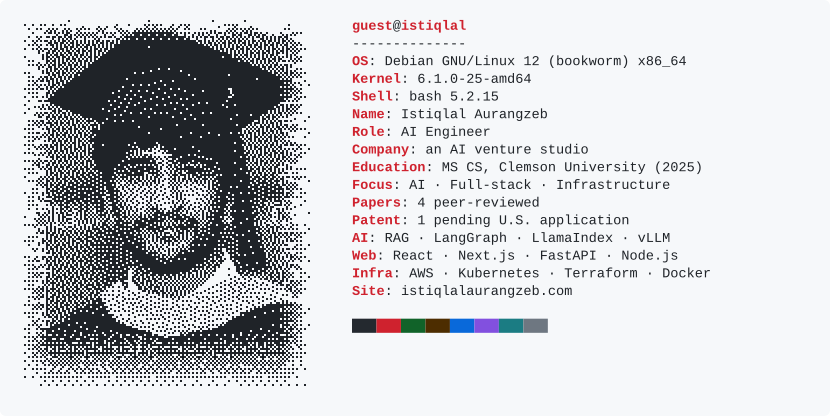

```console
$ ssh guest@istiqlalaurangzeb.com
   _     __  _      __     __                                       __
  (_)__ / /_(_)__ _/ /__ _/ / ___ ___ _________ ____  ___ ____ ___ / /
 / (_-</ __/ / _ `/ / _ `/ / / _ `/ // / __/ _ `/ _ \/ _ `/_ // -_) _ \
/_/___/\__/_/\_, /_/\_,_/_/  \_,_/\_,_/_/  \_,_/_//_/\_, //__/\__/_.__/
              /_/                                   /___/

guest@istiqlalaurangzeb.com's password:
Linux istiqlal 6.1.0-25-amd64 #1 SMP Debian 6.1.106-3 x86_64

AI engineer. I ship production AI end to end: agents, RAG, voice and
vision, plus the cloud infrastructure that runs them.
412 pull requests merged since March 2026.

guest@istiqlal:~$ neofetch
```

<a href="https://www.istiqlalaurangzeb.com/">
  <picture>
    <source media="(prefers-color-scheme: dark)" srcset="./assets/neofetch-dark.svg">
    
  </picture>
</a>

[`linkedin`](https://www.linkedin.com/in/istiqlalbhat) [`scholar`](https://scholar.google.com/citations?user=v4-8HccAAAAJ) [`site`](https://www.istiqlalaurangzeb.com/)

```console
guest@istiqlal:~$ ls -F
about.txt    principles.txt  publications.txt  stack/
patents.txt  projects.txt    shipped.log
```

```console
guest@istiqlal:~$ cat about.txt
I'm an AI engineer at an AI venture studio. I build AI features such
as RAG pipelines and agents, and I work across the full stack to ship
them, from backend APIs to web and mobile frontends. I also handle the
infrastructure side: containerizing services with Docker, deploying them
on Kubernetes, managing AWS resources with Terraform, and setting up
CI/CD with GitHub Actions.

I like owning projects end to end, from the database schema to the
interface people use, and I care about how they perform and hold up
after launch.

I hold an MS in Computer Science from Clemson University (December
2025). At Clemson, I worked as a research software developer, building
AI- and blockchain-based systems for the construction industry,
including a carbon emissions ledger and an automated procurement system
that removes relationship bias from bid evaluation. That research led to
four peer-reviewed publications and a pending U.S. patent application.
```

```console
guest@istiqlal:~$ cat shipped.log
Highlights from production work since March 2026:

[vision]    Two-pass vision pipeline (detect, then identify each object
            from a full-resolution crop) for a home-inventory product
            used in insurance claims. Validated on held-out,
            human-labelled photos: exact-count rate 81% → 83%.
[voice]     Moved a voice assistant with long-term memory from GPT-4o
            Realtime to Gemini Live, cutting the audio flush threshold
            from ~1.5 s to ~0.3 s, and gave it pgvector recall over
            past sessions.
[cloud]     Re-platformed the inventory product onto AWS EKS with
            Terraform. Long LLM jobs run on SQS workers that stream
            progress over SSE and stay correct under at-least-once
            delivery.
[agents]    A multi-tenant platform that gives every workspace its own
            team of AI agents on Kubernetes. I built its registration
            control plane and per-tenant agent rosters, and fenced
            provisioning so stale queue messages can't touch a
            replacement workspace.
[security]  Meeting transcripts reach AI agents only through a
            deny-by-default allowlist, with per-user OAuth and tenants
            isolated by Postgres row-level security.
```

```console
guest@istiqlal:~$ cat projects.txt
evil-llm       Turns Qwen3.5-4B "evil" by pushing two neurons, with no
               system prompt, and maps what the push changes, word by
               word, in live 3D.
               Python · PyTorch · Transformers · FastAPI · three.js

revit-agentic  Lets AI assistants such as Claude read, create and edit
               Autodesk Revit models over MCP: a TypeScript MCP server
               plus a C# Revit add-in, published on npm.
               TypeScript · C# · MCP

portfolio2     My engineering story, built from my GitHub history as a
               scroll-driven 3D timeline.
               JavaScript · three.js · Vite
```

[`open evil-llm`](https://github.com/IstiqlalBhat/evil-llm) [`open revit-agentic`](https://github.com/IstiqlalBhat/revit-agentic) [`open portfolio2`](https://istiqlalbhat.github.io/portfolio2/)

```console
guest@istiqlal:~$ tree ~/stack
~/stack
├── ai .............. PyTorch · Hugging Face · LangGraph · LlamaIndex
│                     Ragas · LangSmith · Weights & Biases
│                     scikit-learn · MCP
├── llm-apis ........ Gemini · Gemini Live · OpenAI Realtime · Claude
├── llmops .......... vLLM · Ollama · llama.cpp · ONNX Runtime
│                     TensorRT · Core ML · LoRA/QLoRA · GGUF
├── languages ....... Python · TypeScript · JavaScript · Dart · Swift
│                     C# · C++ · SQL
├── frontend ........ React · Next.js · Tailwind CSS · Framer Motion
│                     GLSL · WebGPU
├── mobile .......... Flutter · Expo · React Native · Riverpod
│                     EAS Build
├── backend ......... Node.js · FastAPI · Django/DRF · Fastify · GraphQL
│                     gRPC · Celery · Drizzle ORM · Gunicorn
├── data ............ PostgreSQL · pgvector · Pinecone · ChromaDB
│                     Redis · Supabase · Firebase · Better Auth
├── infrastructure .. AWS · Kubernetes · Helm · Terraform · Docker
│                     GitHub Actions · LocalStack
├── blockchain ...... Solidity · Hardhat · ethers.js · Web3.js
└── testing ......... pytest · Vitest · Playwright

11 directories, 71 files
```

```console
guest@istiqlal:~$ cat principles.txt
→ Start with a working version, then let real usage guide the next
  iteration.
→ Keep the architecture simple enough to change as requirements evolve.
→ Measure success by latency, uptime, and user retention.
→ Harden what people depend on with tests, monitoring, and clear
  documentation.
```

```console
guest@istiqlal:~$ cat publications.txt
[1] 2026  Transformational emissions accounting system using BIM- and
          blockchain-enabled smart contracts for building structural
          materials
          Architectural Engineering and Design Management (T&F), vol. 22
          co-author · doi:10.1080/17452007.2026.2632102

[2] 2026  Advancing Active Shooter Evacuation Systems in the Built
          Environment: A Systematic Review and Future Directions
          Advances in Science and Technology (Trans Tech), vol. 173
          co-author · doi:10.4028/p-oG7g3d

[3] 2025  Artificial intelligence- and blockchain-enabled carbon
          emissions ledger system (AB-CELS) for sustainable construction
          processes
          Automation in Construction (Elsevier), vol. 176
          first author · doi:10.1016/j.autcon.2025.106286

[4] 2024  BIM- and blockchain-enabled Automatic Procurement System
          removing relationship bias
          Automation in Construction (Elsevier), vol. 168
          co-author · doi:10.1016/j.autcon.2024.105779
```

[`open [1]`](https://doi.org/10.1080/17452007.2026.2632102) [`open [2]`](https://doi.org/10.4028/p-oG7g3d) [`open [3]`](https://doi.org/10.1016/j.autcon.2025.106286) [`open [4]`](https://doi.org/10.1016/j.autcon.2024.105779)

```console
guest@istiqlal:~$ cat patents.txt
[pending]  US 2026/0099817 A1
           Immutable ledger enabled automatic procurement system
           Blockchain smart contracts that keep subcontractor identities
           anonymous while bids are evaluated.
           co-inventor
```

[`open patent`](https://patents.google.com/patent/US20260099817A1/en)

```console
guest@istiqlal:~$ git log --graph
```

<picture>
  <source media="(prefers-color-scheme: dark)" srcset="https://raw.githubusercontent.com/istiqlalbhat/istiqlalbhat/output/github-contribution-grid-snake-dark.svg" />
  <source media="(prefers-color-scheme: light)" srcset="https://raw.githubusercontent.com/istiqlalbhat/istiqlalbhat/output/github-contribution-grid-snake.svg" />
  
</picture>

```console
guest@istiqlal:~$ cat ~istiqlal/.plan
If you're building something interesting, let's talk.

guest@istiqlal:~$ exit
logout
Connection to istiqlalaurangzeb.com closed.
```
